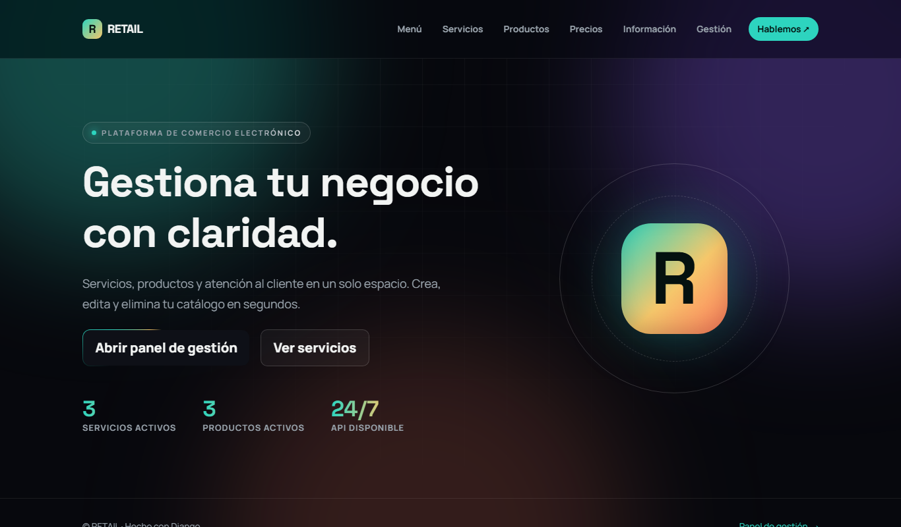
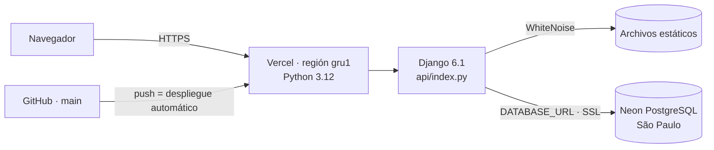

<div align="center">

# RETAIL

**Tienda en Django con catálogo de servicios y productos, panel de gestión con login y diseño oscuro inspirado en React Bits.**

[](https://retail-red.vercel.app)




</div>

## Contenido

- [Funcionalidades](#funcionalidades)
- [Seguridad](#seguridad)
- [Cómo está desplegado](#cómo-está-desplegado)
- [Correr en local](#correr-en-local)
- [Desplegar tu propia copia](#desplegar-tu-propia-copia)
- [Estructura del proyecto](#estructura-del-proyecto)

## Funcionalidades

| | |
| --- | --- |
| 🛍️ **Catálogo público** | Servicios con página de detalle y productos con etiqueta de stock (*En stock*, *Últimas N u.*, *Agotado*). Solo se muestra lo marcado como visible. |
| 🗂️ **Panel de gestión** | En `/gestion/`: resumen con totales, y para servicios y productos se puede **crear, modificar, eliminar y buscar**. Antes de eliminar se pide confirmación. |
| ✅ **Validaciones** | ModelForms con mensajes en español: el nombre necesita al menos 3 caracteres y el precio debe ser mayor a 0. |
| ✉️ **Contacto** | Los mensajes se guardan en la base de datos y se revisan en `/admin/`. Si se configura SMTP, además llegan por correo. |
| 🔌 **API REST** | `/api/servicios/` en JSON. Lectura pública; para escribir hay que iniciar sesión. |
| ✨ **Diseño estilo React Bits** | Aurora, BlurText, ShinyText, GradientText, SpotlightCard, CountUp, StarBorder y ClickSpark, escritos en CSS y JavaScript puro, sin React. Se adapta a celular y respeta la opción de *reducir movimiento*. |

## Seguridad

El sitio publicado aplica las recomendaciones de OWASP y la [lista de verificación de despliegue de Django](https://docs.djangoproject.com/en/6.1/howto/deployment/checklist/) (`manage.py check --deploy` no reporta problemas; solo se silencia el aviso de correo de desarrollo, porque sin SMTP los mensajes de contacto quedan guardados en la base de datos).

| Medida | Detalle |
| --- | --- |
| Secretos fuera del código | `DJANGO_SECRET_KEY` y `DATABASE_URL` son variables de entorno marcadas como *Sensitive* en Vercel. Si falta alguna, el sitio no arranca. |
| Modo producción | En Vercel, `DEBUG` está apagado y las páginas de error no muestran detalles internos. |
| HTTPS obligatorio | Redirección a HTTPS y HSTS por un año (`includeSubDomains`, `preload`). |
| Cookies | Sesión y CSRF con `Secure`, `HttpOnly` y `SameSite=Lax`. La sesión dura 8 horas. |
| Content Security Policy | `script-src 'self'` sin scripts ni estilos inline. Solo se permiten el CDN de Bootstrap y Google Fonts. |
| Integridad de dependencias | Bootstrap se carga desde el CDN con hash SRI: si el archivo fuera alterado, el navegador no lo ejecuta. |
| Otras cabeceras | `X-Frame-Options: DENY`, `X-Content-Type-Options: nosniff`, `Referrer-Policy` y `Cross-Origin-Opener-Policy`. |
| Fuerza bruta | Tras **5 intentos de login fallidos**, ese usuario queda bloqueado 15 minutos desde esa IP (responde HTTP 429). El contador se guarda en la base de datos para que funcione en Vercel. |
| Acceso | Todo el panel exige login; eliminar solo funciona por POST con token CSRF. |
| Base de datos | Neon PostgreSQL con conexión cifrada (`sslmode=require`). |

## Cómo está desplegado



Cada `push` a `main` publica una versión nueva. La función de Vercel y la base de datos están en São Paulo, la región más cercana a Chile.

## Correr en local

Requiere **Python 3.12 o superior**. En local se usa SQLite, así que no necesitas Neon.

```powershell
python -m venv venv
venv\Scripts\python.exe -m pip install -r requirements.txt
venv\Scripts\python.exe manage.py migrate
venv\Scripts\python.exe manage.py createsuperuser   # usuario para entrar al panel
venv\Scripts\python.exe manage.py cargar_demo       # opcional: 3 servicios y 3 productos de ejemplo
venv\Scripts\python.exe manage.py runserver
```

Abre <http://127.0.0.1:8000/>. Para correr las pruebas:

```powershell
venv\Scripts\python.exe manage.py test tiendaApp
```

## Desplegar tu propia copia

1. Crea un proyecto en Vercel desde este repositorio. `vercel.json` ya fija `framework: null`, la región `gru1` y el enrutamiento hacia `api/index.py`.
2. Agrega una base Neon desde el Marketplace de Vercel; eso define `DATABASE_URL`.
3. Define `DJANGO_SECRET_KEY` como variable *Sensitive* con una clave larga y aleatoria:

   ```powershell
   python -c "import secrets; print(secrets.token_urlsafe(64))"
   ```

4. Desde tu computador, apuntando a Neon con la conexión directa (`DATABASE_URL_UNPOOLED`), corre `migrate`, `createcachetable` (necesaria para el límite de intentos de login) y `createsuperuser`.

Las variables opcionales están en [`.env.example`](.env.example):

| Variable | Para qué sirve |
| --- | --- |
| `DJANGO_ALLOWED_HOSTS` | Dominios permitidos. Por defecto, `.vercel.app` en Vercel. |
| `DJANGO_DEBUG` | `False` por defecto en Vercel. Nunca lo actives en producción. |
| `EMAIL_HOST`, `EMAIL_PORT`, `EMAIL_HOST_USER`, `EMAIL_HOST_PASSWORD` | Servidor SMTP para enviar los mensajes de contacto. |
| `CORREO_CONTACTO` | Dirección que recibe los mensajes de contacto. |

## Estructura del proyecto

```text
RETAIL/
├── api/index.py              # Entrada de Vercel (expone la app WSGI)
├── negocio/settings.py       # Configuración (seguridad, base de datos, CSP)
├── tiendaApp/
│   ├── models.py             # Servicio, Producto, MensajeContacto
│   ├── forms.py              # ModelForms con validaciones y login
│   ├── views.py              # Páginas públicas, CRUD del panel, login con límite
│   ├── management/commands/  # cargar_demo
│   └── tests.py              # 18 pruebas
├── templates/                # base.html, tiendaApp/, serviciosApp/ (CRUD, login, precios) y gestion/
├── static/                   # estilo.css y efectos.js (React Bits en JS puro)
└── vercel.json
```

---

<div align="center">

Hecho por [Fernandamv96](https://github.com/Fernandamv96) · [Ver sitio](https://retail-red.vercel.app)

</div>
